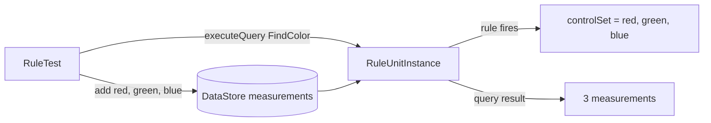

# Drools_VT1.0

Experiments with the Drools 8 rule engine. The repository holds two independent Maven projects:

- **`droolv1`**: a working Drools 8 **Rule Unit** example built as a KJAR, with a passing JUnit test.
- **`drools`**: an early, work-in-progress project for applicant role suggestion and product labelling rules. Only a placeholder `App` and test are compiled today; the model, service and rule files are drafts (see [Status of the `drools` module](#status-of-the-drools-module)).

## droolv1: Rule Unit example

`MeasurementUnit` is a `RuleUnitData` holding a `DataStore<Measurement>` and a `controlSet`. The rules in `src/main/resources/org/droolsv1/rules.drl`:

- Rule **"will execute per each Measurement having ID color"**: for every measurement with `id == "color"`, adds its value to `controlSet`.
- Query **`FindColor`**: returns all measurements with `id == "color"`.



`RuleTest` inserts three `color` measurements, runs the query (which also fires the rules) and asserts that 3 results are returned and that `controlSet` contains `red`, `green` and `blue`.

## Tech stack

| Module | Component | Version |
|--------|-----------|---------|
| `droolv1` | Java | 11 (`maven.compiler.release`) |
| `droolv1` | Drools (BOM, `drools-ruleunits-engine`, `kie-maven-plugin`) | 8.38.0.Final |
| `droolv1` | JUnit / Logback (tests) | 4.13.1 / 1.2.9 |
| `drools` | Java | 11 |
| `drools` | `kie-ci`, `drools-decisiontables` | 8.32.0.Final |
| `drools` | JUnit | 4.11 |

## Project structure

```
Drools_VT1.0/
├── droolv1/                                   # Drools 8 Rule Unit KJAR
│   ├── pom.xml
│   └── src/
│       ├── main/java/org/droolsv1/
│       │   ├── Measurement.java
│       │   └── MeasurementUnit.java           # RuleUnitData
│       ├── main/resources/org/droolsv1/rules.drl
│       └── test/
│           ├── java/org/droolsv1/RuleTest.java
│           └── resources/logback-test.xml
└── drools/                                    # work in progress
    ├── pom.xml
    ├── rules/
    │   ├── SuggestedApplicant.drl             # role suggestion rules
    │   └── Product_rules.xls                  # empty placeholder
    └── src/
        ├── main/java/com/droolsapp/App.java   # prints "Hello World!"
        ├── main/config/DroolsBeanFactory.java # draft, not compiled
        ├── main/model/                        # Applicant, Product, SuggestedRole (not compiled)
        ├── main/service/                      # ApplicantService, ProductService (not compiled)
        └── test/java/com/droolsapp/AppTest.java
```

## Prerequisites

- **`droolv1`: JDK 11 to 17.** The `kie-maven-plugin` 8.38.0.Final build fails on JDK 21 (`java/lang/Compiler` was removed from the JDK).
- **`drools`: JDK 11 or newer.**
- Maven 3.6+

## Build and test

```bash
# Rule Unit example (use JDK 11-17)
cd droolv1
mvn clean test

# Work-in-progress module
cd drools
mvn clean test
```

## Status of the `drools` module

The `drools` module is a draft adapted from a Drools tutorial (its model and service classes still use `com.baeldung.drools.*` packages):

- `SuggestedApplicant.drl` suggests a role (`Manager`, `Senior developer`, `Developer`) from an `Applicant`'s years of experience and current salary, using a `suggestedRole` global.
- `ProductService` is meant to label a `Product` through rules in `Product_rules.xls`, which is currently empty.

These files sit outside Maven's source and resource directories (`src/main/model`, `src/main/service`, `src/main/config`, `rules/`), so they are not compiled or packaged yet. To make them functional they need to be moved under `src/main/java` and `src/main/resources` with consistent package names, and `DroolsBeanFactory` must reference the actual rule file names and paths.
